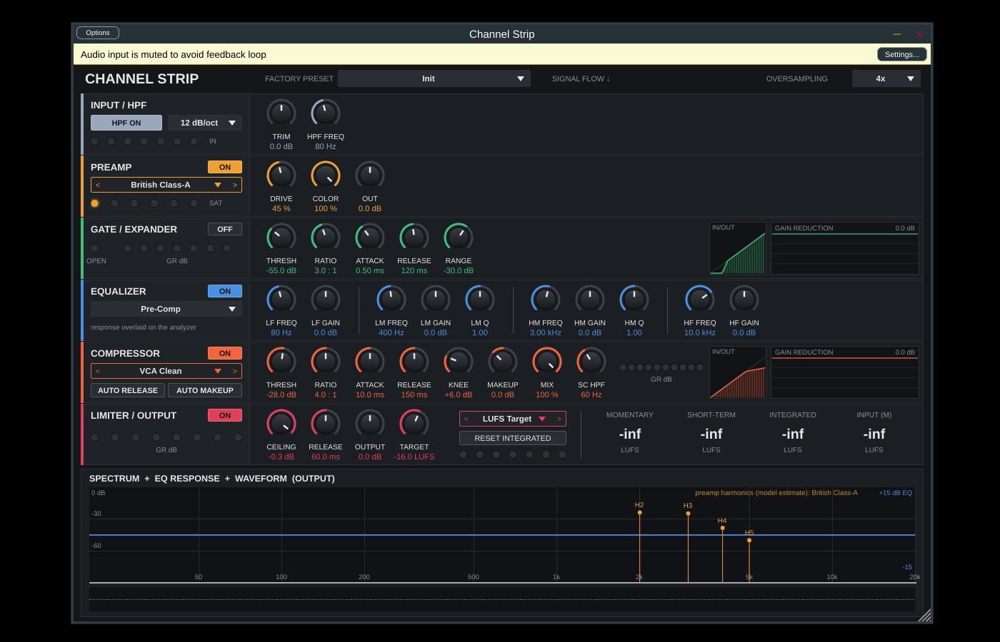

# Channel Strip VST

Channel strip audio plugin (VST3 / AU / CLAP) built with JUCE/C++, derived from an existing Reaper (JSFX) channel strip and extended.



## Goal

Port the existing Reaper channel strip to a cross-DAW plugin format and improve it both in sound/features and in UI.

### Current modules (from the Reaper version)
- **Input / HPF**: trim, high-pass filter with selectable slope
- **Preamp**: saturation models (e.g. "1073 style"), drive, color, output
- **Gate / Expander**: threshold, ratio, attack, release, range, in/out curve and GR meter
- **Equalizer**: 4 bands (LF, LM, HM, HF), pre/post compressor placement
- **Compressor**: VCA-style models, threshold, ratio, attack, release, knee, makeup, mix, sidechain HPF, auto release/makeup
- **Limiter / Output**: ceiling, release, output, LUFS target, loudness metering (momentary, short-term, integrated)
- **Analyzer**: spectrum + EQ response + waveform, oversampling up to 4x, factory presets

### Planned
- VST3, AU and CLAP builds (Windows, macOS, Linux)
- Analysis of graphical and functional improvements (to be defined)

## Status

**Stage 1 – faithful base: done (first version).** All modules of the original strip are implemented,
with the same layout as the Reaper version. Not yet tested inside a DAW.

Signal flow: Input/HPF → Preamp → Gate → EQ (pre-comp) → Compressor → EQ (post-comp) → LUFS auto-gain → Limiter → Output.

Notes on the implementation:
- Preamp models: British Class-A, American Console, Tube Warmth, Tape. Oversampling (1x–8x) applies to the preamp saturation.
- Compressor characters: VCA Clean, FET Punch, Opto Smooth (program-dependent release).
- Limiter: 1.5 ms look-ahead brickwall. In "LUFS Target" mode the gain into the limiter is slowly adjusted (max 1 dB/s, ±18 dB) to reach the target short-term loudness.
- Loudness meter follows ITU-R BS.1770-4 / EBU R128 (momentary, short-term, gated integrated).
- The editor can be resized freely (fixed aspect ratio).

### Next stages
1. Drag-reorderable modules (free signal flow)
2. Dynamic EQ, mid/side, external sidechain
3. A/B compare, undo/redo, user presets, auto gain-match
4. EQ curve editable directly on the analyzer, collapsible modules

## Build

Requirements: CMake ≥ 3.22, a C++17 compiler, git. JUCE 8.0.9 and clap-juce-extensions are downloaded automatically.

```bash
cmake -B build -DCMAKE_BUILD_TYPE=Release
cmake --build build --config Release -j
```

Use `-DJUCE_DIR=/path/to/JUCE` to build against a local JUCE checkout, `-DCS_BUILD_CLAP=OFF` to skip CLAP.

Output in `build/ChannelStrip_artefacts/Release/` (`VST3/`, `CLAP/`, `Standalone/`, and `AU/` on macOS).
On Linux, copy `Channel Strip.vst3` into `~/.vst3/` and `Channel Strip.clap` into `~/.clap/`, then rescan plugins in Reaper.

Linux build dependencies (Fedora):

```bash
sudo dnf install cmake gcc-c++ alsa-lib-devel freetype-devel fontconfig-devel libX11-devel \
  libXcomposite-devel libXcursor-devel libXext-devel libXinerama-devel libXrandr-devel libXrender-devel mesa-libGL-devel
```
